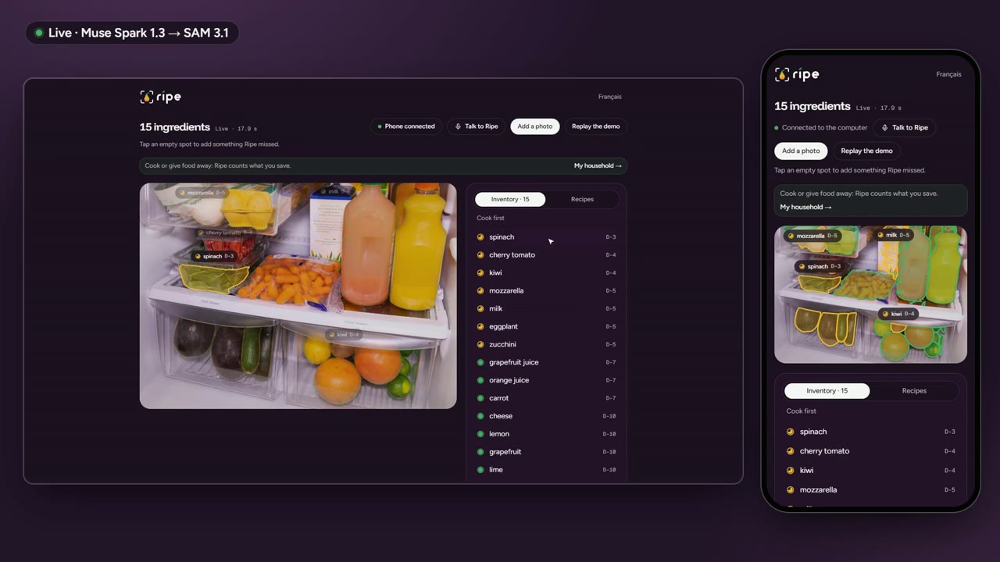

# Ripe — Cook what's ripe

**Snap your fridge. Ripe outlines every ingredient, reads how long each one has left, and cooks what needs eating first.**

[](https://github.com/TheoEwzZer/ripe/raw/main/docs/ripe-demo.mp4)

▶ [Watch the 3-minute demo](https://github.com/TheoEwzZer/ripe/raw/main/docs/ripe-demo.mp4): filmed on the live site with the real Meta models.

Households throw away 79 kg of food per person every year (UNEP Food Waste Index 2024), mostly because something got forgotten at the back of the fridge. Ripe turns one photo of the open fridge into a freshness map, then plans dinners around what is about to go off.

- **Live app:** https://ripe-six.vercel.app (English, French toggle top right)
- **Built for:** Meta Global AI Developer Hackathon 2026, Indie Developer track, theme *Build for Your World*
- **Built during the event:** October 26 to November 4, 2026

## Try it in one minute

1. Open https://ripe-six.vercel.app and press **Start a session**.
2. Press **Try the demo fridge**. This replays a real recorded run of the Meta models on a public-domain fridge photo, so it always works and costs nothing.
3. Hover or tap the outlines. Each item has a freshness pip and a "D-n" badge. Click one to correct its name or days left, or tap an empty spot to add something Ripe missed.
4. Open **See the recipes**, pick filters (quick, no oven, vegetarian…) and press **Suggest 3 recipes**. Recipes stream in, ranked by how much urgent food they rescue. Open one to see the plate Muse Image imagined from your fridge photo.
5. Scan the QR code with your phone: the same session opens there. Take a real photo of your fridge, or film it, and watch the desktop update live. Then send a recipe to the phone and cook hands-free ("next", "timer 5 minutes").

Live analysis of your own photos runs on the real Meta Model API behind a daily budget cap. If the cap is reached, the demo fridge still works.

## How Ripe uses Meta's models

| Model | What it does in Ripe |
| --- | --- |
| **Muse Spark 1.3** (`muse-spark-1.3`) | Reads the fridge photo and streams each item as it is found: name, quantity, category, box, and days left judged from visible cues and where the photo was taken (fridge, freezer, pantry). Also reads printed use-by dates from a close-up, food lines and prices from a receipt, later frames of a fridge video, storage tips, and spoken sentences ("I finished the spinach") turned into list changes. |
| **SAM 3.1** (`sam-3.1`) | Outlines each item on the photo, most urgent first, from a plain noun ("tomato"), with a box prompt as fallback. A tap on the photo becomes a point prompt. On a filmed fridge, SAM 3.1 video follows every item through the clip, each one from the frame where it was first seen. |
| **Muse Wonder 1.0** (`muse-wonder-1.0`) | Writes recipes (1 to 6) or a 2-to-5-day meal plan with a leftover chain, using only ingredients from the photo and the pantry. Ingredient names are an enum in the JSON schema, so it cannot invent food the household does not have. It also rewrites a recipe without one ingredient on request. |
| **Muse Image 1.0** (`muse-image-1.0`) | Imagines the finished plate from the fridge photo, and the "after" fridge once the rescued food is gone. |
| **Muse Voice Transcribe 1.0** (`muse-voice-transcribe-1.0`) | Transcribes spoken sentences in the kitchen, and powers hands-free cooking through Meta's realtime transcription stream. |

## What it does

**See the fridge**
- Streaming analysis: items appear one by one while Muse Spark is still reading, then SAM draws each outline.
- Freshness map: colour plus a draining pip and a "D-n" label, so it reads without colour too.
- Correct the AI: rename, change days left, remove and undo, merge duplicates across photos, tap to add a missed item.
- Several photos (fridge, freezer, pantry) feed one inventory. A receipt adds what was just bought, with prices. A close-up reads a printed date.
- Film the fridge: the first frame is analysed like a photo, later frames are checked for items it missed, and SAM tracks everything through the clip.

**Cook it first**
- Recipes ranked by an anti-waste score (how much of the urgent food they use), with filters for time, equipment, diet and number of dishes.
- Meal plans that chain leftovers from one day to the next, exportable to a calendar (.ics).
- Recipe sheet with the plate image, what comes from the fridge (cropped from the photo), what comes from the pantry, and anything left to buy.
- Cooking mode on the phone: one step per screen, timers parsed from the steps, screen kept awake, voice commands, read-aloud steps.

**Share and keep going**
- Desktop and phone stay in sync live through Convex. A blurred preview of the phone photo reaches the desktop before the upload ends.
- Offer what you won't eat in time: a public link shows a crop of each item and one "I'll take it" button.
- Impact counter: kilograms, euros and CO₂e saved, using ADEME's Agribalyse 3.2 factors, receipt prices when known, and Ripe's indicative prices otherwise. A household page keeps 30 days and a zero-waste streak.
- Reminder the evening before food goes off (Web Push), a 1080×1920 story card to share a recipe, and an installable PWA.

## Architecture

```
Phone / desktop (Next.js 16, React 19, Tailwind 4)
        │  live queries and mutations
        ▼
Convex (database, file storage, scheduled actions, crons)
        │  actions, each paid call behind spend.reserve / spend.settle
        ▼
Meta Model API ── Muse Spark · SAM 3.1 · Muse Wonder · Muse Image · Muse Voice
        ▲
Vercel function app/api/listen ── WebSocket relay for realtime transcription
```

- **One pipeline, two sources.** `lib/pipeline` runs perception, then segmentation, against either the live API or a recording. Recordings in `fixtures/recordings/` are raw model outputs replayed through the same parsers, so the demo is the real system, not a mock.
- **Money safety.** Every paid call reserves an estimate against a daily cap (`convex/spend.ts`, `META_DAILY_BUDGET_USD`) and settles on the measured cost. Each session also has its own limits on photos, videos, recipe runs, plates and voice. A photo, three recipes and a plate cost about $0.10 to $0.15.
- **No accounts.** A session is an anonymous kitchen reached by its URL or a 4-character code. A household is a random id kept on the device. Public offer links expose names, quantities and photo crops, never ids of the giver's kitchen. Receipt and date close-ups are deleted once read, and sessions are purged after 24 hours.

## Lessons from the real models

- SAM 3.1 returns nothing for descriptive phrases ("box of green spinach") and for items cut by the photo edge. Ripe asks Muse Spark for a plain noun just for SAM, and falls back to box prompts.
- Muse Wonder invented pantry items until ingredient names became an enum in the response schema. One correction round fixes the rare recipe that still breaks a rule.
- SAM video accepts box prompts on any frame and tracks in both directions, so an item first seen 5 seconds into the clip is tracked from there.
- The realtime transcription API takes the API key in its first WebSocket frame, so the browser cannot connect directly: a small relay on Vercel holds the key and forwards only the prepaid seconds of audio.

## Run it locally

```bash
npm install
npm run dev          # Convex dev deployment + Next.js
```

Open the URL Next prints (`/en` or `/fr`). Without a Convex account, `CONVEX_AGENT_MODE=anonymous npm run dev` runs a local backend instead.

Without `MODEL_API_KEY` in the Convex environment, everything runs on the recordings and costs nothing. With a key, live analysis turns on, capped by `META_DAILY_BUDGET_USD` (default $1 a day).

| Variable | Where | Purpose |
| --- | --- | --- |
| `MODEL_API_KEY` | Convex, and Vercel for the realtime relay | Meta Model API key |
| `META_DAILY_BUDGET_USD` | Convex | Daily spending cap |
| `VAPID_PUBLIC_KEY`, `VAPID_PRIVATE_KEY` | Convex | Web Push reminders (`npx web-push generate-vapid-keys`) |
| `CONVEX_DEPLOY_KEY` | Vercel | Deploys Convex functions with each build (`vercel.json`) |

Hands-free cooking prefers Meta's realtime stream, which needs a WebSocket relay. `next dev` cannot upgrade WebSockets, so run the relay on its own locally:

```bash
npm run listen-relay                                         # ws://localhost:8790
NEXT_PUBLIC_LISTEN_URL=ws://localhost:8790 npm run dev:frontend
```

Without the relay, cooking mode falls back to one recorded clip per sentence.

### Scripts

```bash
npm run typecheck                                # next typegen + tsc
npm run check:pipeline                           # offline checks of parsers, scoring and the pipeline
npm run fixtures:mock                            # rebuild the synthetic recording
npm run probe                                    # one real pass on a photo, capped by META_BUDGET_USD (default $0.25)
npm run probe -- --steps perceive                # stop after Muse Spark
npm run record:recipes -- --locale en --plates   # real recipes and plates for the demo photo
npm run record:recipes -- --locale fr --plan     # a real meal plan
npm run record:tips                              # storage tips for the demo photo
npm run probe:track -- --video clip.mp4 --width 960 --height 720 --boxes "x1,y1,x2,y2;…"   # one SAM video call
```

`/lab` shows the newest recording as a freshness map.

## Layout

- `app/[lang]/` — routes, English by default with a French toggle (`proxy.ts` picks the locale): home, session `s/[id]`, recipe sheet and cooking mode, join `j`, household `foyer`, offer `o/[offerId]`
- `app/api/listen` — realtime transcription relay; `app/api/story` — story card image
- `convex/` — schema and functions: sessions, devices, scans, ingredients, masks, tracks, recipes, offers, impact, reminders, spend cap, crons
- `lib/meta/` — Meta Model API calls: perception, segmentation, video tracking and sweep, recipes, plates, voice, dates, receipts, tips
- `lib/pipeline/`, `lib/replay/` — the shared pipeline and the recordings it replays
- `lib/recipes/` — filters, pantry, validation, anti-waste score, meal plans, timers
- `lib/voice/` — spoken commands, sentence interpretation, the relay
- `lib/impact.ts` — Agribalyse factors and the impact counter
- `brand/` — logo files

## Credits

- Demo photos: Alabama Extension (CC0) and USDA (public domain), via Wikimedia Commons. See `public/fixtures/photos/CREDITS.md`.
- Carbon factors: ADEME Agribalyse 3.2, via the Impact CO2 open data. Household waste figure: UNEP Food Waste Index Report 2024.
- Fonts: Funnel Display, Figtree and Geist Mono (Google Fonts, OFL).
